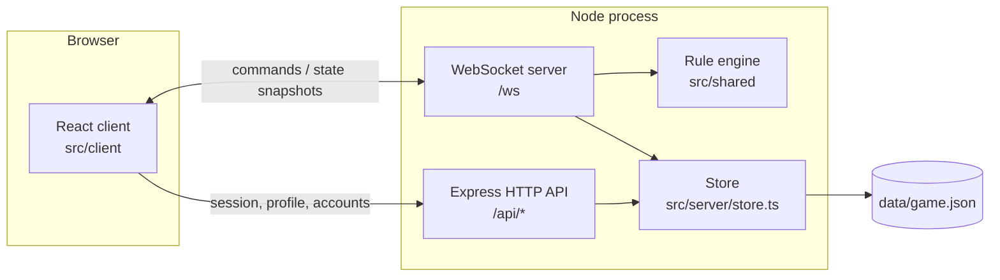

# Architecture

Just One More is a single Node.js process that serves the React client, a small JSON HTTP API, and a WebSocket endpoint from one port. The server owns all game state and randomness; browsers only render state and send commands.

## Components

| Path                     | Responsibility                                                                                       |
| ------------------------ | ---------------------------------------------------------------------------------------------------- |
| `src/shared/types.ts`    | State and command contracts shared by client, server, and tests.                                     |
| `src/shared/engine.ts`   | Authoritative rule engine: deck, turns, special-card resolution, settlement, bot choices.            |
| `src/shared/scoring.ts`  | Pure score breakdowns, used by the engine and the UI.                                                |
| `src/server/app.ts`      | HTTP endpoints, WebSocket handling, validation (Zod), sessions, rate limits, room lifecycle, timers. |
| `src/server/store.ts`    | Persistence: in-memory database written atomically to a JSON snapshot.                               |
| `src/server/serve.ts`    | Shared startup: configuration, listening, LAN URLs, graceful shutdown.                               |
| `src/server/index.ts`    | Production entry: serves the built client from `dist/client`.                                        |
| `src/server/dev.ts`      | Development entry: mounts Vite in middleware mode for hot reloading.                                 |
| `src/client/useGame.ts`  | Reconnecting WebSocket client and request lifecycle.                                                 |
| `src/client/App.tsx`     | Dashboard, profiles, room setup, application shell.                                                  |
| `src/client/components/` | Table, hands, cards, roulette, dialogs, rules.                                                       |
| `src/client/styles/`     | Base styles, app themes, card designs, motion.                                                       |

## Rules

[rules.md](rules.md) is the rules contract. An extra Second Chance passes automatically to the next active, unprotected seat in join order; the rules require transferring extras but not how the recipient is selected, and seat order keeps the resolution immediate.

## Product decisions

- A room and its game share one five-character code. Seats follow join order. The room holds 2–8 players, with a configurable maximum. Two participants are sufficient to start; four or more work in the same way.
- The creator is implicitly ready. Everyone else must mark themselves ready. Changing settings clears human ready flags. Only the host starts rounds or rematches.
- Public discovery lists this server’s public lobbies and games. In-progress games are visible but cannot receive new players. Existing members can reconnect. Private tables require a code/link and do not appear in discovery.
- One user can actively belong to one room. Explicitly departed players can join another; their old seats automatically finish any unresolved round decisions.
- Guest access includes the full game and visual designs. Optional accounts add cross-device identity and durable access to statistics. There are no artificial gameplay restrictions, email requirements, external identity providers, payments, or password-recovery promises.
- Accounts are local to this installation, identified by a case-insensitive username. Changing a display nickname does not change that account’s login username.
- Round counts, best round, and best total update after each settled round, including busted rounds and practice games. Games and wins update once when a game finishes. A persisted checkpoint per game prevents rounds from being counted again after chat, reconnect, or restart. Older saves backfill available unfinished-game history; completed games already included their rounds and are not counted again. History from rooms already deleted cannot be recovered. A rematch resets totals and hands, retains settings and connected seats, and returns to the waiting room.
- Every hand has a special-card row above a number-card row, including frozen or disabled cards in their respective rows. Prediction multipliers appear with special cards. Rows scroll horizontally when needed. Both banked and busted players are out for the round: their cards receive an animated light gray shadow, with an immediate state change under reduced motion. Opponent hands remain visible in round results.
- Bot choices are heuristics, not hidden-deck analysis. They inspect public hands and scores only. They must resolve exactly the same legal prompts as human players.
- Sound is off by default and stored per browser. Appearance is saved with the profile. All number and effect cards remain public, as in the tabletop rules.

## State flow and consistency

The game engine runs only on the server. Its state machine resolves physical draws, then queued action cards, then the remaining opening deal or ordinary turn. Target, exact-number prediction, and final bank choices are explicit prompts. Reaching ten or exhausting every eligible card cancels unfinished effects and enters final banking. Scores settle only after the whole round.

Clients receive a public projection that omits the draw pile, discards, and effect queues. They never shuffle, choose random results, or write scores. Each game action includes a state version; a stale action is rejected with a refreshed snapshot. Successful request IDs are deduplicated per player (last 512 in process), and state versions protect game actions after a restart. There is no automatic retry of an uncertain action; the player sees the current state before deciding again.

Room mutations are synchronous in one process. Committed snapshots are written to a temporary file with restrictive file permissions, then atomically renamed. Room shuffles and roulette use Node’s cryptographic random source.

## Sessions, security, and disconnects

- Sessions use random 256-bit bearer cookies (HttpOnly, SameSite=Strict, `Secure` on HTTPS) that last 30 days; only their SHA-256 hashes are stored. Expired sessions are removed periodically and their sockets closed. Passwords are salted with scrypt and never returned to browsers.
- State-changing HTTP requests and WebSocket upgrades from other origins, including `null` or malformed origins, are rejected. Zod validates every external input. Oversized messages, invalid commands, and command bursts are bounded or rejected; client errors return 4xx, unexpected failures 500 without details.
- Responses carry a strict Content-Security-Policy (self-hosted scripts, styles, fonts, and connections only), `Cross-Origin-Opener-Policy`, `Cross-Origin-Resource-Policy`, `Permissions-Policy`, `X-Frame-Options`, and HSTS on HTTPS. The development server disables the CSP because Vite injects inline scripts.
- Rate limits (guest creation, sign-in, WebSocket upgrades, commands) use the client IP. Behind a proxy, `TRUST_PROXY` decides whose forwarded IP and protocol are believed.
- Human sessions have a WebSocket heartbeat. When a player disconnects, their current decision gets a 30-second grace period; if other humans remain, an automatic safe bank or legal special-card choice keeps play moving. The seat stays available to reconnect. A table with no connected humans pauses.
- A departing host passes control to another human; a returning human can reclaim host control from a bot. Explicitly leaving an ongoing table is remembered across restarts, and the same player can rejoin with its code. If everyone explicitly leaves, the room closes. Unoccupied rooms expire after 24 hours of inactivity.

## Hosting

The app runs locally or in Docker and listens on `0.0.0.0`, so friends on the same network can join through the host's LAN IP. For internet sessions, `compose.tunnel.yaml` adds an accountless Cloudflare Quick Tunnel sidecar that forwards HTTPS and WebSocket traffic to the local app. See [deployment.md](deployment.md). Permanent hosting is planned in [technical-plan.md](technical-plan.md).

## Operational boundaries

One process owns its data file; the file store is not suitable for multiple instances, and snapshots are not an operational backup. Account recovery, moderation tooling, spectators, and matchmaking across servers are not implemented. The game rules stay isolated in `src/shared` so new cards and rule variants can be added without changing transport or presentation. The migration to SQLite and further hardening are tracked in [technical-plan.md](technical-plan.md).
