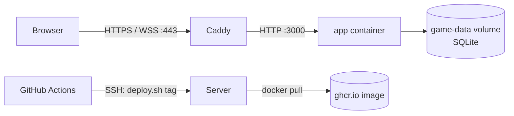

# Deployment and operations

The app is one Node.js process serving HTTP and WebSockets on a single port. It can run directly with Node.js, in Docker, or in Docker with a public Cloudflare Quick Tunnel.

## Configuration

| Variable        | Default     | Purpose                                                                                                                                                                                                                                    |
| --------------- | ----------- | ------------------------------------------------------------------------------------------------------------------------------------------------------------------------------------------------------------------------------------------ |
| `PORT`          | `3000`      | HTTP and WebSocket port.                                                                                                                                                                                                                   |
| `DATA_DIR`      | `./data`    | Directory containing the SQLite database `just-one-more.db` (plus its `-wal`/`-shm` files while running).                                                                                                                                  |
| `TRUST_PROXY`   | (unset)     | Which proxies may supply the client IP and protocol via `X-Forwarded-For`/`X-Forwarded-Proto`. Same values as Express `trust proxy`: a hop count (`1`), or addresses/subnets (`loopback`, `uniquelocal`, `10.0.0.1`). Unset trusts nobody. |
| `COOKIE_SECURE` | (unset)     | Unset: session cookies are `Secure` when the request is HTTPS (directly or via a trusted proxy). `true`/`false` force the flag.                                                                                                            |
| `LOG_LEVEL`     | `info`      | `fatal`, `error`, `warn`, `info`, `debug`, `trace`, or `silent`. `debug` adds static file requests, WebSocket connects, and rejected commands.                                                                                             |
| `METRICS_PORT`  | (unset)     | When set, serves Prometheus metrics at `/metrics` on this port, on a separate listener. The public port never exposes them.                                                                                                                |
| `METRICS_HOST`  | `127.0.0.1` | Address of the metrics listener. In Docker use `0.0.0.0` and do not publish the port publicly (see below).                                                                                                                                 |

Example: `PORT=8080 DATA_DIR=./demo-data npm start`.

Only set `TRUST_PROXY` when clients cannot reach the app except through that proxy; otherwise anyone can fake their IP address for rate limiting.

## Health checks

- `GET /api/health`: liveness; the process answers.
- `GET /api/ready`: readiness; `200` when the database answers and its file is writable, `503` otherwise. The Docker image uses this check.

## Logs and metrics

The server writes one JSON object per line to stdout ([pino](https://getpino.io)); `npm run dev` prints them in a readable format instead. Each HTTP response carries an `X-Request-Id` header, and the matching log line has the same `req.id`. API requests are logged at `info`; health checks are not logged. Logs contain pseudonymous user IDs but no cookies, session tokens, passwords, or IP addresses.

With `METRICS_PORT` set, `GET /metrics` returns:

| Metric                                                                              | Type    | Meaning                                                       |
| ----------------------------------------------------------------------------------- | ------- | ------------------------------------------------------------- |
| `jom_websocket_connections`                                                         | gauge   | Open WebSocket connections.                                   |
| `jom_connected_users`                                                               | gauge   | Users with at least one open connection.                      |
| `jom_rooms{phase}`                                                                  | gauge   | Active rooms per phase.                                       |
| `jom_commands_total{result}`                                                        | counter | Commands: `ok`, `rejected` (rule/validation), `failed` (bug). |
| `jom_websocket_messages_total{type}`                                                | counter | Broadcast `state` and `rooms` messages.                       |
| `jom_http_responses_total{status}`                                                  | counter | HTTP responses by status class (`2xx`, `4xx`, `5xx`, …).      |
| `process_resident_memory_bytes`, `nodejs_heap_used_bytes`, `process_uptime_seconds` | gauge   | Process health.                                               |

In Docker, set `METRICS_PORT: '9464'` and `METRICS_HOST: '0.0.0.0'` on the app service. Reach it from another container on the same Compose network (for example a Prometheus sidecar at `http://app:9464/metrics`), or publish it to the host's loopback only with `ports: ['127.0.0.1:9464:9464']`.

## Load testing

`tests/load/tables.js` is a [k6](https://k6.io) script (install k6 separately). Each table has four scripted human players: the host creates a public table, the others find it in the room list, join, and mark themselves ready, and everyone plays (draw until three cards, then bank; answer target and prediction prompts) and chats every 10 seconds. Extra lobby clients only watch the room list. Players arrive 20 ms apart.

```sh
npm run build
ulimit -n 8192   # macOS defaults to 256 open files, too few for hundreds of sockets
PORT=3456 TRUST_PROXY=loopback DATA_DIR=$(mktemp -d) LOG_LEVEL=warn METRICS_PORT=9464 npm start
# in a second terminal (also run `ulimit -n 8192` there)
npm run test:load -- -e BASE_URL=http://127.0.0.1:3456 -e TABLES=75 -e LOBBY_CLIENTS=25
```

`TRUST_PROXY=loopback` lets each virtual player send its own `X-Forwarded-For` address; without it, the per-IP rate limits stop the test. Never use that setting for a server that is reachable from outside. Options: `TABLES` (default 10, at most 100 because of the room limit), `LOBBY_CLIENTS` (10), `DURATION_SECONDS` (60), `THINK_MS` (400), `RAMP_MS` (20). Thresholds: p95 command latency below 250 ms, fewer than 10 command errors.

**Baseline** (2026-10-13, Apple M3 Pro, Node 22, production build, 75 tables × 4 players + 25 lobby clients, 60 s):

| Measure                           | Result                                                  |
| --------------------------------- | ------------------------------------------------------- |
| Open WebSockets                   | 325                                                     |
| Commands                          | ~200/s, 13 199 ok, 6 rejected (stale version), 0 failed |
| Command latency (send \u2192 ack) | median 2 ms, p95 4 ms, max 29 ms                        |
| Broadcast messages                | ~800 `state`/s, ~23 `rooms`/s                           |
| Server CPU                        | 15\u201328 % of one core                                |
| Server memory (RSS)               | ~130 MB                                                 |

The room limit (100) is reached long before CPU or memory. A small VPS with one vCPU and 512 MB\u20131 GB RAM is therefore enough for the current limits; repeat the test on the chosen host (O-02) before raising them.

## Run with Node.js

Requires Node.js 24 (see `.nvmrc`) and npm.

```sh
npm ci
npm run build
npm start
```

`npm start` runs the built server (`dist/server/index.js`) with `NODE_ENV=production`; it serves the client from `dist/client`. The production build bundles fonts, icons, and all assets locally; gameplay has no third-party service dependency. Ctrl+C stops the server.

## Run with Docker

Requires Docker with the Compose plugin. Node.js is not required on the host.

```sh
docker compose up --build -d
```

Open **http://localhost:3000**. For friends on your local network, use the **host computer's LAN IP**, such as `http://192.168.1.42:3000`; the network address printed inside the container belongs to Docker and is not the invitation address.

```sh
docker compose ps          # includes the HTTP health-check status
docker compose logs -f app
docker compose down        # stop and remove the container; keep saved data
```

To use another host port, run `PORT=8080 docker compose up --build -d` and open `http://localhost:8080`. The internal port remains 3000. Behind your own HTTPS reverse proxy, set `TRUST_PROXY` to the proxy's address (or hop count) so cookies, HSTS, and rate limits use the original request.

The `Dockerfile` has two stages (build, runtime), so it also works on hosts that limit builds to two stages. The runtime image contains only the built `dist/` output and production dependencies, runs as the unprivileged `node` user, and checks `/api/ready`. Source changes require rebuilding the image.

## Saved data and backups

Games, accounts, and sessions persist in the Compose-managed `game-data` volume mounted at `/app/data` (or in `DATA_DIR` when running with Node.js). Rebuilds and container replacement retain this data. **`docker compose down --volumes` deletes it.** Run **one server process per data directory**.

The database contains rooms, accounts, hashed passwords, profile statistics, and hashed session tokens. Treat backups as private. In production, the VPS provider's daily server backups are the backup (see [Backups and restore](#backups-and-restore)). For a one-off copy, stop the app so the database is checkpointed into a single file, then copy it:

```sh
mkdir -p backups
docker compose stop app
docker compose cp app:/app/data/just-one-more.db ./backups/just-one-more-$(date +%F).db
docker compose start app
```

To restore, stop the app, copy the backup to `/app/data/just-one-more.db` (with `docker compose cp`), remove any `just-one-more.db-wal` and `-shm` files next to it, and start the app. If the file cannot be opened as a database on startup, the server renames it to `just-one-more.db.corrupt-<timestamp>`, logs an error, and starts with empty data, so the original can still be inspected or restored. Retention runs automatically: expired sessions, guest profiles that can no longer sign in, and rooms without activity for 24 hours are removed (see [architecture.md](architecture.md#persistence)).

## Play over the internet with a Quick Tunnel

Start the Cloudflare Quick Tunnel in the foreground with the Compose override. Compose also starts the app:

```sh
docker compose -f compose.yaml -f compose.tunnel.yaml up --build tunnel
```

Wait for the `https://….trycloudflare.com` URL in the output. Open that URL yourself, create a table, and share its invitation link. Everyone, including the host, must use the same tunnel URL. Friends only need a browser; no shared Wi-Fi, port forwarding, Cloudflare account, domain, or token is required. Keep the terminal open and the computer awake while playing.

The tunnel waits for the app's readiness check and forwards HTTP and WebSockets to `app:3000`. In this mode the app port is **not** published on the host, so the app is only reachable through the tunnel; this makes the forwarded client IP and protocol trustworthy (`TRUST_PROXY=uniquelocal`). Use the tunnel URL from every device, including the host computer. Session cookies are always `Secure` in this mode.

Restarting the tunnel gives it a new hostname. Browser cookies belong to the old hostname, so guest identities and saved seats do not follow to a new URL; accounts can sign in again. Saved game data stays in the volume.

```sh
docker compose -f compose.yaml -f compose.tunnel.yaml stop tunnel   # stop public access only
docker compose -f compose.yaml -f compose.tunnel.yaml down          # stop both, keep data
```

To return to local HTTP play, run `down`, then `docker compose up -d` without the override.

### Cost and limits

Checked **2026-10-09**: Cloudflare describes Quick Tunnels as free and accountless. This setup supplies no card or billing account and creates no subscription or trial. See [Cloudflare's service description](https://blog.cloudflare.com/protected-quick-tunnels/).

Quick Tunnels allow **200 in-flight requests**; excess requests fail with **HTTP 429** rather than becoming paid overages. They have no uptime guarantee and change hostname on restart. WebSockets are supported. This suits small 2–8-player sessions; rehearse on the actual participant networks. See [Quick Tunnel limits](https://developers.cloudflare.com/tunnel/get-started/quick-tunnels/) and [WebSocket behavior](https://developers.cloudflare.com/network/websockets/).

Anyone with the URL can access the server. A private table hides it from discovery but does not restrict access to the website. Stop the tunnel when the session is over.

If the URL does not load, check `docker compose -f compose.yaml -f compose.tunnel.yaml ps` and the tunnel logs. The host network must allow outbound connections to Cloudflare on port **7844** (UDP for QUIC or TCP for HTTP/2). See [tunnel firewall requirements](https://developers.cloudflare.com/cloudflare-one/networks/connectors/cloudflare-tunnel/configure-tunnels/tunnel-with-firewall/).

## LAN troubleshooting

If a friend cannot connect on the local network, ensure both devices share a network, use the printed IP address rather than `localhost`, and check that the host firewall permits incoming connections on the chosen port. Guest Wi-Fi with client isolation may prevent LAN play. Each player needs a separate device, browser profile, or private window; tabs in the same profile share an identity.

## Production on a VPS

Permanent hosting runs on one small Linux VPS with Docker Compose: [Caddy](https://caddyserver.com) terminates HTTPS (automatic Let's Encrypt certificates) and forwards HTTP and WebSockets to the app. The app port is not published, so only Caddy can reach it; that is why `TRUST_PROXY=uniquelocal` is safe. Files: [`deploy/`](../deploy/).



The load test shows that 1 vCPU and 1–2 GB RAM are plenty (see [Load testing](#load-testing)). Images are built for `linux/amd64`, so choose an x86 server.

### One-time server setup

1. **Server:** Ubuntu LTS, SSH key login only. Enable the provider's **automatic backups** (daily server snapshots; this is the backup strategy, see below). Firewall: allow 22, 80, 443 (TCP) and 443 (UDP) only.
2. **DNS:** an `A` (and `AAAA` for IPv6) record for the domain pointing to the server. Caddy needs it before it can obtain a certificate.
3. **Base software:** Docker Engine with the Compose plugin; `unattended-upgrades` for security updates.
4. **Deploy user:** create a user `deploy` in the `docker` group (note: Docker access is equivalent to root on that machine) and the directory `/opt/just-one-more` owned by it.
5. **Files:** copy `deploy/compose.yaml`, `deploy/Caddyfile`, and `deploy/deploy.sh` to `/opt/just-one-more`, and `deploy/.env.example` to `/opt/just-one-more/.env`. Set `DOMAIN` in `.env`.
6. **Image access:** make the GHCR package `just-one-more` public (GitHub → Packages → Package settings → Change visibility), or run `docker login ghcr.io` as `deploy` with a token that has only `read:packages`.
7. **First start:** as `deploy` in `/opt/just-one-more`: `./deploy.sh latest`, then `docker compose up -d` (starts Caddy). Open `https://<domain>`.

### Automatic deployment

Every push to `main` that passes all CI jobs publishes `ghcr.io/<owner>/just-one-more:sha-<commit>` and `:latest`, then runs the [Deploy workflow](../.github/workflows/deploy.yml). It connects over SSH and runs `deploy.sh sha-<commit>`. The script pulls the image, replaces the app container, and waits for the health check; if the new version is not healthy within two minutes, it switches back to the previous tag and the workflow fails. Pull requests never deploy. The deploy job is skipped until the variables below exist, so CI stays green before the server is set up.

Set up a dedicated SSH key for CI that can do nothing but deploy:

```sh
ssh-keygen -t ed25519 -N '' -C github-deploy -f deploy_key
# On the server, one line in ~deploy/.ssh/authorized_keys:
command="/opt/just-one-more/deploy.sh",no-port-forwarding,no-agent-forwarding,no-X11-forwarding,no-pty ssh-ed25519 AAAA… github-deploy
# The host key for known_hosts (compare the fingerprint with the provider console):
ssh-keyscan -t ed25519 <server>
```

In the GitHub repository (Settings → Environments → `production`; no required reviewers):

| Name                 | Kind     | Value                                                                                              |
| -------------------- | -------- | -------------------------------------------------------------------------------------------------- |
| `DEPLOY_SSH_KEY`     | Secret   | Content of `deploy_key` (private key). Delete the local file afterwards.                           |
| `DEPLOY_KNOWN_HOSTS` | Secret   | Output of `ssh-keyscan`.                                                                           |
| `DEPLOY_HOST`        | Variable | Server host name or IP. Must be a **repository** variable: it decides whether the deploy job runs. |
| `DEPLOY_USER`        | Variable | `deploy`                                                                                           |
| `DEPLOY_URL`         | Variable | `https://<domain>`; checked after each deployment.                                                 |

### Rollback

Run the **Deploy** workflow manually (Actions → Deploy → Run workflow) with an older tag, for example `sha-1a2b3c4`; the tags are listed on the GHCR package page. On the server, `./deploy.sh sha-1a2b3c4` does the same. Database migrations only move forward: a release that changes the schema must stay readable by the previous release, otherwise roll back by restoring a backup.

### Backups and restore

The provider's automatic server backups (daily, kept for about a week) contain the whole disk, including the Docker volume with the database. SQLite in WAL mode is safe to snapshot while running: a snapshot behaves like a sudden power cut, and SQLite recovers the last committed transaction on the next start. There is no separate off-site copy; a backup taken on the same provider does not protect against losing the provider account.

- **Restore the whole server:** in the provider console, restore the latest backup (or create a new server from it), then check `https://<domain>/api/ready`.
- **Restore only the database:** create a temporary server from a backup, copy `/var/lib/docker/volumes/just-one-more_game-data/_data/just-one-more.db` from it, then on the production server stop the app, copy the file into the volume (`docker compose cp`), remove `-wal`/`-shm` files, and start the app.
- Before risky operations, take a manual snapshot in the provider console.

### Operations

| Task            | Command (as `deploy` in `/opt/just-one-more`)                               |
| --------------- | --------------------------------------------------------------------------- |
| Status          | `docker compose ps`                                                         |
| Logs            | `docker compose logs -f app` (JSON; pipe through `npx pino-pretty` to read) |
| Restart         | `docker compose restart app`                                                |
| Current version | `grep IMAGE_TAG .env`                                                       |
| Update Caddy    | `docker compose pull caddy && docker compose up -d caddy`                   |
| Disk usage      | `docker system df`                                                          |

Container logs rotate automatically (5 × 10 MB per container, see `deploy/compose.yaml`). Caddy keeps its certificates in the `caddy-data` volume; do not delete it, or Let's Encrypt rate limits may delay a new certificate. Uptime monitoring is not set up yet (O-04 deferred).

## Choosing a paid or free hosting service

Before relying on any external service, verify and record in [architecture.md](architecture.md):

- Current free-tier or price conditions, and whether an account or credit card is required.
- Usage limits and whether they suffice; whether exceeding them stops the service or triggers charges.
- Whether a trial converts automatically to a paid plan, and any temporary card authorization holds.
- Steps required to prevent charges or cancel resources afterward.
- WebSocket support, idle timeouts, cold starts or sleeping, and persistent disk support for the data directory.

Do not rely on billing alerts alone to prevent costs, and do not enable paid plans or overages without explicit approval. See [technical-plan.md](technical-plan.md) for the permanent hosting plan.
