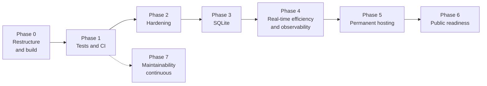
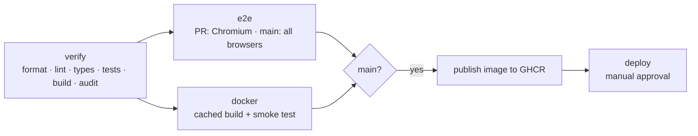

# Technical Plan: From Hackathon MVP to Permanent Hosting

Status: **In progress** · Created 2026-10-13 · Updated 2026-10-13 · See the progress table below for implemented tasks.

## 1. Context and decisions

| Topic             | Decision                                                                                                   |
| ----------------- | ---------------------------------------------------------------------------------------------------------- |
| Hosting           | Short-term tests keep the Cloudflare Quick Tunnel. Long term the app is hosted permanently.                |
| Persistence       | Replace the JSON snapshot (`data/game.json`) with **SQLite**.                                              |
| Audience          | Friends now; **open public traffic** later. Hardening is sized for public traffic, rolled out in phases.   |
| Legal             | No company. Ship **template** Impressum and privacy policy pages with placeholders; review before go-live. |
| Quality guarantee | Unit, integration, and end-to-end tests run in CI and block merges, protecting refactorings and upgrades.  |
| Build and runtime | Vite builds both client and server. Production runs plain `node`; `tsx` is a dev-only tool.                |
| Repository        | Single package, sources under `src/{client,server,shared}`, minimal README, all other docs in `docs/`.     |
| Documentation     | Hackathon-era documents are removed (kept in Git history); only current, maintained docs remain.           |
| Non-goals for now | Horizontal scaling / multiple instances, payments, external identity providers, native apps, spectators.   |

The architecture stays a **single Node process** that owns its SQLite file and serves HTTP + WebSockets from one port. This keeps operations simple and matches SQLite's single-writer model.

## 2. Baseline (2026-10-13)

| Check                    | Result                                       |
| ------------------------ | -------------------------------------------- |
| `tsc --noEmit` (strict)  | Passes                                       |
| `vitest run`             | 86 tests pass (engine, presentation, server) |
| `prettier --check`       | Clean                                        |
| `npm audit --omit=dev`   | 0 vulnerabilities                            |
| CI                       | **None** (`.github/` does not exist)         |
| Linting                  | **None** (no ESLint)                         |
| Frontend / browser tests | **None**                                     |
| Coverage reporting       | **None**                                     |

Strengths to preserve: server-authoritative engine with crypto randomness, Zod validation on every external input, scrypt passwords, hashed session tokens, SameSite=Strict cookies, origin checks, versioned actions with request de-duplication, atomic writes, non-root Docker image with health check.

## Progress

| Phase | Status   | Notes                                                                                                                                                                                                                                                                                                                                                                                                                                                                                                |
| ----- | -------- | ---------------------------------------------------------------------------------------------------------------------------------------------------------------------------------------------------------------------------------------------------------------------------------------------------------------------------------------------------------------------------------------------------------------------------------------------------------------------------------------------------- |
| 0     | **Done** | C-01 … C-10 implemented. Additions: `docs/features.md` keeps the detailed feature list from the old README; `src/server/serve.ts` holds shared startup used by `dev.ts`, `index.ts`, and the e2e server; client-only packages (React, icons, fonts) moved to `devDependencies`; Node 24 LTS.                                                                                                                                                                                                         |
| 1     | **Done** | T-01 … T-09 implemented. Deviations: tests are grouped as `unit`, `client` (jsdom: components and browser helpers), `integration`, `e2e`; TypeScript downgraded from 7.0 to 6.0 so `typescript-eslint` works (T-03); jsx-a11y uses the maintained `eslint-plugin-jsx-a11y-x` fork for ESLint 10. Existing hook/a11y findings are warnings with a ceiling (M-07). The axe scan found and fixed invalid `aria-label` uses; known color-contrast and scrollable-region findings are allowlisted (M-08). |
| 2–7   | Open     | Next: Phase 2 hardening.                                                                                                                                                                                                                                                                                                                                                                                                                                                                             |

## 3. Guiding principles

1. **Safety net first.** Tests and CI land before any behavior-changing refactoring or the SQLite migration. The purely mechanical restructure (Phase 0) comes first so new tests are written in their final location; it is guarded by the existing 86 tests, `tsc`, the production build, and a Docker build.
2. **Small, reviewable PRs.** Each task below is roughly one PR and must be green in CI.
3. **Every bug fix ships with a regression test** at the lowest level that reproduces it.
4. **No test-only code paths in the production entry point.** Test hooks (seeded randomness, short timers) are injected through `createApplication(options)` from a dedicated test entry.
5. **Configuration through environment variables**, documented in `docs/deployment.md`.

## 4. Roadmap



Phases 0–3 are required before permanent hosting for friends. Phase 6 is required before open public traffic. Phase 7 runs continuously once the test safety net (Phase 1) exists.

### Phase 0 — Repository restructure and build

**Target layout** (single npm package; no monorepo/workspaces, which would add overhead without benefit at this size):

```text
.
├── .github/              CI workflows and Renovate/Dependabot config (Phase 1)
├── docs/
│   ├── architecture.md   Architecture, product assumptions, operational boundaries
│   ├── deployment.md     Docker, Quick Tunnel, configuration, backups, hosting checklist
│   ├── development.md    Setup, scripts, testing, project layout, conventions
│   ├── rules.md          The implemented game rules (single source of truth)
│   └── technical-plan.md This plan
├── public/               Static files copied verbatim (favicon)
├── src/
│   ├── client/           React app: main.tsx, App.tsx, hooks, components/, styles/
│   ├── server/           Express + WebSocket server, persistence
│   └── shared/           Engine, scoring, types used by client, server, and tests
├── tests/                unit/, components/, integration/, e2e/ (Phase 1)
├── compose.yaml
├── compose.tunnel.yaml
├── Dockerfile
├── index.html            Vite entry (stays at the root by Vite convention)
├── package.json · package-lock.json
├── tsconfig.json         Solution file referencing the two configs below
├── tsconfig.client.json  DOM + JSX, includes src/client and src/shared
├── tsconfig.node.json    Node types, no DOM, includes src/server, src/shared, tests, configs
├── vite.config.ts        Client build, server SSR build, and Vitest projects
├── eslint.config.js      (Phase 1)
├── .editorconfig · .nvmrc · .gitignore · .dockerignore · .prettierrc.json · .prettierignore
└── README.md             Minimal: what it is, quick start, links into docs/
```

**Server runtime decision.** Vite cannot replace the Node server process itself (Express + `ws` must run in Node), but it can **build** it:

| Mode        | Command                                                                                          | Notes                                                                                        |
| ----------- | ------------------------------------------------------------------------------------------------ | -------------------------------------------------------------------------------------------- |
| Development | `tsx watch src/server/dev.ts` (Vite runs inside it in middleware mode, as before)                | `tsx` becomes a **devDependency**. One port, HMR for the client, restart on server edits.    |
| Build       | `vite build` (client → `dist/client`) + `vite build --ssr src/server/index.ts` (→ `dist/server`) | One toolchain for both bundles; npm dependencies stay external and come from `node_modules`. |
| Production  | `node dist/server/index.js`                                                                      | Plain Node, no TypeScript loader, faster start, smaller image.                               |

Why not Node's built-in TypeScript support instead of `tsx`: it requires `.ts` extensions on every relative import and only erasable syntax (e.g. `server/store.ts` uses a constructor parameter property), and it gives no production build. It can replace `tsx` in development later (`node --watch`) once the team runs a Node LTS where type stripping is stable; that is an optional follow-up, not part of this phase.

| ID   | Task                                                                                                                                                                                                                                                                                                                                                                                        | Acceptance criteria                                                                                                       |
| ---- | ------------------------------------------------------------------------------------------------------------------------------------------------------------------------------------------------------------------------------------------------------------------------------------------------------------------------------------------------------------------------------------------- | ------------------------------------------------------------------------------------------------------------------------- |
| C-01 | Delete outdated hackathon documents: `PROJECT_DESCRIPTION.md`, `SPEC.md`, `tech-constraints.md`, `docs/ai-workflow.md`, `docs/verification.md`. Carry over only still-valid content (the zero-cost service checklist from `tech-constraints.md` §3 → `docs/deployment.md`).                                                                                                                 | Files removed; no dangling links (`grep` for the file names is empty); history remains in Git.                            |
| C-02 | Move `game-rules.md` → `docs/rules.md` and keep only the final rules. Remove the SP-01 investigation metadata (status, branch, checkpoint, observations, alternatives). Keep the tabletop fixture as a "Worked example" because engine tests reproduce it. **Add rules implemented after v1.0** that are missing today: the AI Hackathon card (reverse mode) and Flip Three self-targeting. | `docs/rules.md` describes exactly what the engine implements; engine tests reference its section names.                   |
| C-03 | Turn `docs/decisions.md` into `docs/architecture.md`: architecture overview (with a Mermaid component diagram), product assumptions, operational boundaries. Remove hackathon history and references to deleted documents.                                                                                                                                                                  | Current, accurate description of the system; no references to deleted files.                                              |
| C-04 | Rewrite `README.md` to be minimal: one-paragraph description, short feature list, quick start (Docker and Node), links to `docs/`. Move Docker/tunnel/configuration/backup content to `docs/deployment.md`; scripts, verification, and project layout to `docs/development.md`.                                                                                                             | README fits on roughly one screen; every removed section exists in a `docs/` file.                                        |
| C-05 | Move this plan to `docs/technical-plan.md`.                                                                                                                                                                                                                                                                                                                                                 | Root contains only README and configuration files.                                                                        |
| C-06 | Move sources with `git mv` (preserves history): `src/*` → `src/client/` (CSS into `src/client/styles/`), `server/` → `src/server/`, `shared/` → `src/shared/`. Update imports, `index.html`, Vite/Vitest config, Dockerfile, `.dockerignore`, and scripts.                                                                                                                                  | No behavior change: `tsc`, all tests, `vite build`, and the Docker build pass; `git log --follow` works on moved files.   |
| C-07 | Split TypeScript configuration into `tsconfig.client.json` (DOM, JSX) and `tsconfig.node.json` (Node, no DOM) referenced from `tsconfig.json`; `src/shared` is checked by both.                                                                                                                                                                                                             | Using DOM globals in server code or Node APIs in client code fails type checking.                                         |
| C-08 | Build the server with Vite SSR as described above; output `dist/client` and `dist/server`. Resolve static paths relative to the module (`import.meta.dirname`), not the working directory. Select production mode via `NODE_ENV=production`. Move `tsx` to devDependencies.                                                                                                                 | `npm run build && npm start` serves the app with plain `node`; integration tests run against the built server once in CI. |
| C-09 | Single two-stage `Dockerfile` (build stage: `npm ci`, build, `npm prune --omit=dev`; runtime stage: `dist/` + production `node_modules`, non-root, health check, `CMD ["node", "dist/server/index.js"]`). Delete `Dockerfile.small` and its README section.                                                                                                                                 | One Dockerfile that also satisfies hosts limited to two stages; image no longer contains TypeScript sources or `tsx`.     |
| C-10 | Root configuration hygiene: merge `vitest.config.ts` into `vite.config.ts` (Vitest projects); Prettier scripts become `prettier . --check` / `--write` driven by `.prettierignore` (drop deleted files from it); add `.editorconfig` and `.nvmrc` matching the Docker base image and `engines`.                                                                                             | Fewer root files; formatting covers all tracked sources and docs automatically.                                           |

### Phase 1 — Test and CI foundation

| ID   | Task                                                                                                                                                                                                                     | Acceptance criteria                                                                                      |
| ---- | ------------------------------------------------------------------------------------------------------------------------------------------------------------------------------------------------------------------------ | -------------------------------------------------------------------------------------------------------- |
| T-01 | Restructure tests into `tests/unit`, `tests/client`, `tests/integration`, `tests/e2e`; configure Vitest projects (`node` env for server/shared, `jsdom` env for React).                                                  | `npm run test:unit`, `test:client`, and `test:integration` run independently; existing tests still pass. |
| T-02 | Add `@vitest/coverage-v8` with thresholds (start at current coverage, ratchet upward; target ≥ 90 % for `src/shared/`, ≥ 80 % for `src/server/`).                                                                        | `npm run test:coverage` fails below thresholds; report uploaded as a CI artifact.                        |
| T-03 | Add ESLint (flat config) with `typescript-eslint`, React hooks, jsx-a11y, Vitest, and Playwright plugins. Requires TypeScript 6.0 until `typescript-eslint` supports TypeScript 7.                                       | `npm run lint` passes; added to `npm run check`.                                                         |
| T-04 | Allow injecting `random` into `createApplication` (defaults to crypto random) so integration and e2e tests can be deterministic.                                                                                         | Production entry unchanged in behavior; tests can pass a seeded PRNG.                                    |
| T-05 | Add React component tests with `@testing-library/react` for `HandCards`, `Roulette`, `Rules`, `Appearance`, `AudioControls`, dialogs in `ui.tsx`, and pure client helpers (`roulette.ts`, `motion.ts`, `appearance.ts`). | Each component has render + interaction tests; helpers have unit tests.                                  |
| T-06 | Set up Playwright (`@playwright/test`) with a dedicated test server entry (`tests/e2e/server.ts`) serving the **production build** with seeded randomness, short bot delay, and a temp data dir.                         | `npm run test:e2e` builds, starts, and tests the app headlessly on Chromium, Firefox, and WebKit.        |
| T-07 | Write the critical-journey e2e suite (see §5.2) including an accessibility scan with `@axe-core/playwright`.                                                                                                             | Suite runs < 5 min in CI; no serious/critical axe violations.                                            |
| T-08 | Add GitHub Actions workflow (see §6).                                                                                                                                                                                    | Required status checks enabled on `main` via branch protection.                                          |
| T-09 | Add Renovate or Dependabot with grouped weekly updates.                                                                                                                                                                  | Update PRs open automatically and run the full pipeline.                                                 |

### Phase 2 — Hardening (deployment blockers)

| ID   | Task                                                                                                                                                                                                                        | Acceptance criteria                                                                                                 |
| ---- | --------------------------------------------------------------------------------------------------------------------------------------------------------------------------------------------------------------------------- | ------------------------------------------------------------------------------------------------------------------- |
| H-01 | **Real client IP behind proxies.** Add `TRUST_PROXY` config and use Express `req.ip` for rate limiting (HTTP and WebSocket upgrade). Only trust `CF-Connecting-IP` / `X-Forwarded-For` when configured.                     | Integration test: two clients with different forwarded IPs get separate limits; spoofed headers ignored by default. |
| H-02 | Derive the `Secure` cookie flag from the request (`req.secure` with trusted proxy), keep `COOKIE_SECURE` as an override.                                                                                                    | Tunnel and HTTPS hosting work without manual env changes; tests cover both.                                         |
| H-03 | Security headers: strict **Content-Security-Policy** (self-only scripts, styles, fonts, `connect-src 'self'` incl. `ws:`/`wss:`), `Strict-Transport-Security` on HTTPS, `Permissions-Policy`, `Cross-Origin-Opener-Policy`. | Integration test asserts headers; e2e suite passes with CSP enforced (no console CSP violations).                   |
| H-04 | Error handling: return 500 for unexpected errors, 400 only for client errors (JSON parse, validation). Handle `Origin: null` / malformed origins explicitly.                                                                | Tests for malformed JSON, bad origin, thrown handler error.                                                         |
| H-05 | Validate the persisted data on startup; on corruption move the file aside and start cleanly with a loud log entry. (Superseded by SQLite in Phase 3, but needed while JSON remains.)                                        | Test: corrupted file → server starts, file renamed with timestamp.                                                  |
| H-06 | Send error-triggered state refreshes only to the requesting client instead of `broadcast()` to everyone.                                                                                                                    | Integration test: an invalid command from A does not produce a message on B.                                        |
| H-07 | Background cleanup job: delete expired sessions hourly; when the cleanup deletes stale rooms, also clear their timers and persist.                                                                                          | Tests with fake timers.                                                                                             |
| H-08 | Health endpoints: `/api/health` (liveness) and `/api/ready` (storage writable).                                                                                                                                             | Docker `HEALTHCHECK` uses readiness; tests cover failure mode.                                                      |

### Phase 3 — SQLite persistence

Details in §7.

| ID   | Task                                                                                                                                                | Acceptance criteria                                                                                                    |
| ---- | --------------------------------------------------------------------------------------------------------------------------------------------------- | ---------------------------------------------------------------------------------------------------------------------- |
| D-01 | Introduce a `Repository` interface that `app.ts` uses instead of reaching into `store.data` directly. Keep the JSON implementation behind it first. | No behavior change; all tests green. This isolates the switch.                                                         |
| D-02 | Implement the SQLite repository with versioned migrations, WAL mode, foreign keys, and transactions per command.                                    | Repository contract tests run against both implementations (in-memory SQLite for speed).                               |
| D-03 | One-time importer: if `game.json` exists and the DB is empty, import it in one transaction and rename the JSON file to `game.json.imported`.        | Integration test with a fixture snapshot (including legacy fields) verifies users, sessions, rooms, and stats survive. |
| D-04 | Retention policy: prune expired sessions, guest users without session/room after 30 days, finished-game bookkeeping after 90 days.                  | Tests with controlled clock; growth is bounded.                                                                        |
| D-05 | Online backup: `npm run backup` / scheduled job using the SQLite backup API (`VACUUM INTO`), documented restore procedure.                          | Backup can be taken while the server runs; restore tested in an integration test.                                      |
| D-06 | Remove the JSON store and update `docs/deployment.md`, `docs/architecture.md` (`DATABASE_FILE` replaces `DATA_DIR/game.json`).                      | No references to the JSON store remain except the importer.                                                            |

### Phase 4 — Real-time efficiency and observability

| ID   | Task                                                                                                                                          | Acceptance criteria                                                                                    |
| ---- | --------------------------------------------------------------------------------------------------------------------------------------------- | ------------------------------------------------------------------------------------------------------ |
| R-01 | Index `userId → roomCode` and `roomCode → sockets` in memory instead of scanning all rooms for each client.                                   | `roomFor` is O(1); unit tests on the index.                                                            |
| R-02 | Scoped broadcasting: room updates only to room members; public room list sent to lobby clients, throttled (e.g. max 1×/s) and only on change. | Integration test: a change in room A sends nothing to members of room B except throttled list updates. |
| R-03 | Do not persist or broadcast when a connect/disconnect changes nothing.                                                                        | Test counts writes/messages.                                                                           |
| R-04 | Load test script (e.g. k6 or a Node script with `ws`) simulating N tables × 4 players; record baseline numbers in `docs/deployment.md`.       | Documented capacity estimate for the chosen host size.                                                 |
| R-05 | Structured JSON logging (e.g. `pino`) with request IDs; no secrets/tokens in logs; log level via env.                                         | Log lines are JSON in production, pretty in development.                                               |
| R-06 | Optional metrics endpoint (connected sockets, active rooms, command rate, error rate), protected or bound to an internal port.                | Metrics visible to the operator only.                                                                  |

### Phase 5 — Permanent hosting

Server compilation and the single Dockerfile moved to Phase 0 (C-08, C-09).

| ID   | Task                                                                                                                                                                          | Acceptance criteria                                                |
| ---- | ----------------------------------------------------------------------------------------------------------------------------------------------------------------------------- | ------------------------------------------------------------------ |
| O-01 | Static asset caching: `immutable`, 1 year for hashed `/assets/*`; `no-cache` for `index.html`; real 404 for missing asset files instead of the SPA fallback. Add compression. | Integration test on headers; Lighthouse check in e2e optional.     |
| O-02 | Choose host (see §8), set up a domain, TLS, persistent volume, and off-site backups.                                                                                          | Documented runbook: deploy, rollback, restore backup, rotate logs. |
| O-03 | Continuous delivery: on tag/merge to `main`, publish image to GHCR; deploy manually approved (GitHub environment protection).                                                 | One-click, reproducible deploy of a tested image.                  |
| O-04 | Uptime monitoring against `/api/ready` with alerting.                                                                                                                         | Alert reaches the team when the app is down.                       |

### Phase 6 — Public readiness

| ID   | Task                                                                                                                                                      | Acceptance criteria                                               |
| ---- | --------------------------------------------------------------------------------------------------------------------------------------------------------- | ----------------------------------------------------------------- |
| S-01 | Account self-service: change password, delete account (and personal data), sign out of all sessions.                                                      | Integration + e2e tests; deletion removes user rows and sessions. |
| S-02 | Legal pages: template **Impressum** and **privacy policy** (see §9), linked from the footer and the account dialog.                                       | Pages reachable without login; placeholders clearly marked.       |
| S-03 | Abuse management: chat rate limit per room, simple word filter, host can mute/kick in lobby and during the game, report button that logs to the operator. | Tests for each moderation command.                                |
| S-04 | Bot/crawler protection: create a guest user lazily on the first meaningful action (create/join/practice), not on every page load.                         | Visiting the landing page creates no DB rows (integration test).  |
| S-05 | Global capacity limits: max rooms, max sockets per IP and per user, max concurrent connections; graceful "server busy" UI.                                | Tests for each limit.                                             |
| S-06 | Clear content note in the footer/rules: no real money, no purchases, no prizes.                                                                           | Visible on landing page and rules.                                |

### Phase 7 — Maintainability (continuous)

| ID   | Task                                                                                                                                                                                                                       | Acceptance criteria                                         |
| ---- | -------------------------------------------------------------------------------------------------------------------------------------------------------------------------------------------------------------------------- | ----------------------------------------------------------- |
| M-01 | Split `src/client/App.tsx` (~1 300 lines) into screen components (dashboard, profile, account, room setup) and hooks.                                                                                                      | No file > ~400 lines; e2e suite unchanged and green.        |
| M-02 | Split `src/client/components/Table.tsx` (~1 000 lines) into seat, hand, prompt, standings, and log components.                                                                                                             | Component tests per extracted part.                         |
| M-03 | Split `src/server/app.ts` into `http/`, `ws/`, `rooms/` (command handlers), `scheduler/` (timers), `security/` (rate limit, headers, auth).                                                                                | Unit tests for command handlers and scheduler without HTTP. |
| M-04 | Reduce CSS size (~9 000 lines across `styles.css`, `themes.css`, `motion.css`): co-locate per component, consolidate theme tokens as CSS variables.                                                                        | Visual regression screenshots in Playwright stay unchanged. |
| M-05 | Client resilience: handle non-JSON responses (proxy 502/503 pages) in `api()` with a clear message.                                                                                                                        | Unit test with mocked `fetch`.                              |
| M-06 | Fill `package.json` metadata (author, license decision).                                                                                                                                                                   | Licence chosen deliberately.                                |
| M-07 | Resolve existing lint warnings (React refs/effects/dependencies, jsx-a11y labels and roles) and promote those rules to errors.                                                                                             | `npm run lint` passes with `--max-warnings 0`; e2e green.   |
| M-08 | Fix the remaining axe findings: color contrast in several themes (lobby and table) and a scrollable region without keyboard access on the table; then remove them from the allowlist in `tests/e2e/accessibility.spec.ts`. | Axe scan passes with an empty allowlist in all themes.      |

## 5. Testing strategy

### 5.1 Test pyramid and layout

```text
tests/
  unit/            Fast, no I/O. Engine, scoring, repository (in-memory SQLite),
                   rate limiter, scheduler (fake timers).
  client/          Vitest + jsdom + Testing Library: components and browser helpers.
  integration/     Real HTTP + WebSocket server on a random port, temp DB.
                   Auth, rooms, persistence, migrations, headers, limits.
  e2e/             Playwright against the production build in real browsers.
    server.ts      Test entry: serve(..., { random: seeded, botDelay: 100, ... })
    fixtures.ts    Helpers for players, tables, and playing a round.
  support/         Shared helpers (seeded random generator).
```

| Level       | Tooling                                | Runs on           | Target duration |
| ----------- | -------------------------------------- | ----------------- | --------------- |
| Unit        | Vitest (`node` env)                    | Every push / PR   | < 10 s          |
| Client      | Vitest + Testing Library (`jsdom` env) | Every push / PR   | < 20 s          |
| Integration | Vitest + real `http`/`ws`              | Every push / PR   | < 60 s          |
| E2E         | Playwright (Chromium, Firefox, WebKit) | Every PR + `main` | < 5 min         |
| Smoke       | Docker image + `curl`/Playwright smoke | Every PR + `main` | < 3 min         |

Scripts: `test:unit`, `test:client`, `test:integration`, `test:coverage`, `test:e2e` (see `docs/development.md`).

### 5.2 What each level must cover

**Unit**

- All rule paths in `src/shared/engine.ts` and `src/shared/scoring.ts` (existing suite, extended): special cards, reverse mode, deck recycling, ties, bot legality for every prompt type.
- Property-style tests: for many seeds, a full game always terminates, scores are never negative unless the rules allow it, and the deck card count is preserved.
- Repository contract tests (users, sessions, rooms, stats, retention) against in-memory SQLite.
- Rate limiter, client-IP resolution, origin validation, cookie parsing.
- Scheduler (bot turns, disconnect auto-actions, host transfer) with fake timers.

**Component**

- Hands show special and number rows; banked/busted state; reduced-motion behavior.
- Roulette shows the server result and can be skipped.
- Dialogs: keyboard focus trap, Escape closes, labels present.
- Appearance/audio controls persist choices.

**Integration**

- Existing server tests (four-client sync, reconnect, stale/replayed commands, lobby authorization, auth, restart persistence).
- New: proxy IP handling, security headers/CSP, error status codes, JSON-to-SQLite import, backup/restore, retention, scoped broadcasting, capacity limits, account deletion.

**E2E critical journeys** (each player = separate browser context)

1. First visit → practice game with bots → finish a round → see score breakdown.
2. Host creates a private table → second player joins via invitation link → both ready → play until round end → scores match on both screens.
3. Reconnect: player reloads mid-turn and keeps seat; disconnect grace period triggers automatic bank.
4. Register account → sign out → sign in in a fresh context → profile and stats preserved.
5. Theme, card design, and full-screen mode switching; Escape exits full screen.
6. Mobile viewport (e.g. iPhone and Pixel profiles) for the table screen.
7. Accessibility scan (`@axe-core/playwright`) on landing, lobby, table, rules.
8. Optional visual regression screenshots of key screens per theme (enabled once M-04 starts).

### 5.3 Determinism rules

- Randomness is injected (T-04); e2e uses a fixed seed so draws are reproducible.
- No `waitForTimeout`; wait on visible state or the WebSocket `state` messages.
- Each test gets its own temp database and server port; no shared state between tests.
- Flaky tests are quarantined with an issue link, not retried silently (Playwright `retries: 1` only in CI, failures still reported).

## 6. CI/CD pipeline (GitHub Actions)



- Triggers: pull requests and pushes to `main` (not for docs-only changes), a weekly schedule (catches upstream/browser drift), and manual runs.
- Runs are kept small for limited Actions usage: one Node version (`.nvmrc`), a single `npm ci` for all static checks, tests, and the build; Chromium-only e2e on pull requests; cached Playwright browsers and Docker layers; superseded runs are cancelled.
- Artifacts: coverage report, Playwright HTML report and traces on failure.
- `npm audit --omit=dev --audit-level=high` blocks on high/critical advisories in production dependencies.
- Branch protection on `main`: all jobs required, at least one review, linear history.
- Dependency updates (T-09): grouped by ecosystem (React, Vite/Vitest, types, lint), weekly; auto-merge allowed only for dev-dependency patch updates with a fully green pipeline.

## 7. SQLite design

### 7.1 Driver

| Option           | Pros                                                         | Cons                                                                                       |
| ---------------- | ------------------------------------------------------------ | ------------------------------------------------------------------------------------------ |
| `better-sqlite3` | Mature, fast, synchronous API fits the single-process model. | Native module; prebuilt binaries usually available, otherwise needs build tools in Docker. |
| `node:sqlite`    | No dependency, built into Node.                              | Stability level must be verified for the Node LTS we deploy on.                            |

**Recommendation:** `better-sqlite3`, unless `node:sqlite` is marked stable in the chosen Node LTS at implementation time. No ORM; plain SQL with a tiny migration runner.

### 7.2 Schema (initial)

```sql
CREATE TABLE schema_migrations (version INTEGER PRIMARY KEY, applied_at INTEGER NOT NULL);

CREATE TABLE users (
  id            TEXT PRIMARY KEY,
  username      TEXT UNIQUE COLLATE NOCASE,
  password_hash TEXT,
  salt          TEXT,
  name          TEXT NOT NULL,
  color         TEXT NOT NULL,
  theme         TEXT NOT NULL,
  appearance    TEXT NOT NULL,
  account       INTEGER NOT NULL DEFAULT 0,
  games         INTEGER NOT NULL DEFAULT 0,
  wins          INTEGER NOT NULL DEFAULT 0,
  best_score    INTEGER NOT NULL DEFAULT 0,
  rounds        INTEGER NOT NULL DEFAULT 0,
  best_round    INTEGER NOT NULL DEFAULT 0,
  created_at    INTEGER NOT NULL,
  last_seen_at  INTEGER NOT NULL
);

CREATE TABLE sessions (
  token_hash TEXT PRIMARY KEY,
  user_id    TEXT NOT NULL REFERENCES users(id) ON DELETE CASCADE,
  expires_at INTEGER NOT NULL
);
CREATE INDEX sessions_expires ON sessions(expires_at);
CREATE INDEX sessions_user ON sessions(user_id);

CREATE TABLE rooms (
  code       TEXT PRIMARY KEY,
  game_id    TEXT NOT NULL,
  is_public  INTEGER NOT NULL,
  phase      TEXT NOT NULL,
  state      TEXT NOT NULL,          -- JSON of the full Room; engine stays unchanged
  updated_at INTEGER NOT NULL
);
CREATE INDEX rooms_updated ON rooms(updated_at);

CREATE TABLE game_progress (
  game_id        TEXT PRIMARY KEY,
  recorded_round INTEGER NOT NULL,
  completed      INTEGER NOT NULL DEFAULT 0,
  updated_at     INTEGER NOT NULL
);
```

### 7.3 Runtime model

- Pragmas: `journal_mode=WAL`, `synchronous=NORMAL`, `foreign_keys=ON`, `busy_timeout`.
- Active rooms stay in an in-memory cache (single process = authoritative); every committed command writes the room row **and** stat updates in one transaction.
- Room state is stored as JSON to keep `src/shared/engine.ts` untouched; searchable columns (`phase`, `is_public`, `updated_at`) are denormalized.
- Configuration: `DATABASE_FILE` (default `./data/just-one-more.db`). Docker volume stays at `/app/data`.
- Backups: `VACUUM INTO` to a timestamped file; host-level job copies backups off-site.

## 8. Hosting plan

**Requirements:** one long-running container, persistent disk for SQLite, WebSocket support without short idle timeouts, HTTPS with own domain (stable cookies), no cold-start sleep that drops games, predictable cost with hard limits.

| Option                                                      | Notes                                                                                               |
| ----------------------------------------------------------- | --------------------------------------------------------------------------------------------------- |
| Small VPS + Docker Compose + reverse proxy (e.g. Caddy)     | Full control, persistent disk, automatic TLS; we operate OS updates and backups ourselves.          |
| PaaS with persistent volumes (e.g. Fly.io, Railway, Render) | Less ops; check volume support, WebSocket timeouts, sleep behavior, and single-instance pinning.    |
| Own always-on machine + **named** Cloudflare Tunnel         | Reuses today's tunnel approach with a stable hostname; depends on home hardware and network uptime. |

Before choosing, verify the hosting checklist (moved from `tech-constraints.md` §3 into `docs/deployment.md` by C-01): current free tier/price, card requirement, usage limits, behavior on exceeding limits, automatic upgrades, card holds, and cancellation steps. Record the result in `docs/architecture.md`.

Quick Tunnel remains the documented path for short tests (`compose.tunnel.yaml`), with `TRUST_PROXY` set so rate limits use `CF-Connecting-IP`. Note: in that setup the app port is also published on the host; trusted proxy headers must only be honored for traffic coming from the tunnel container.

## 9. Legal templates (no company)

> Not legal advice. Have the final texts reviewed before opening to the public.

- **Impressum** (`/impressum`): placeholder for the responsible natural person's name, a postal address where they can be served (ladungsfähige Anschrift), and a contact email, plus a note that this is a private, non-commercial project. Whether § 5 DDG applies to a purely private, non-commercial service is a judgement call; providing it is the safer default for a public site.
- **Privacy policy** (`/privacy`), Art. 13 GDPR: controller contact, data processed (nickname, optional username, scrypt password hash, session cookie, game stats, chat messages, IP addresses in logs/rate limiting), purposes and legal bases (Art. 6(1)(b) to provide the game, Art. 6(1)(f) for security/abuse prevention), retention periods (from D-04 and log retention), hosting provider as processor, data subject rights, right to complain to a supervisory authority.
- **Cookies/local storage:** only strictly necessary storage (session cookie, local UI preferences) → no consent banner required under § 25(2) TDDDG, as long as no analytics or third-party embeds are added.
- Self-service deletion (S-01) implements the right to erasure.

## 10. Open questions

1. SQLite driver: confirm `better-sqlite3` vs `node:sqlite` at implementation time.
2. Hosting provider, budget ceiling, and domain name.
3. Upgrade the runtime from Node 22 to the current Node LTS as part of C-09 (and pin it in `.nvmrc`)?
4. Who is named in the Impressum (one team member) and which contact address is used?
5. Accounts: add an optional email for password recovery (adds personal data and an email provider)?
6. Moderation scope for public chat (S-03): is a word filter + mute/kick enough initially?
7. Should the public table list stay enabled for open traffic, or start with private/invite-only tables?
8. Later: replace `tsx` in development with Node's native TypeScript support once on a Node LTS where it is stable?

## 11. Traceability: analysis findings → tasks

| Finding                                                       | Task(s)           |
| ------------------------------------------------------------- | ----------------- |
| Rate limits use the socket IP (shared behind tunnel/proxy)    | H-01, H-02        |
| Unbounded growth of guests, sessions, bookkeeping             | H-07, D-04, S-04  |
| Synchronous full-file write on every event                    | D-02, R-03        |
| Corrupt `game.json` crashes startup                           | H-05, D-02        |
| Missing CSP/HSTS                                              | H-03              |
| Broadcast to all clients, including on errors                 | H-06, R-01, R-02  |
| All server errors return 400                                  | H-04              |
| Short cache for hashed assets, no compression                 | O-01              |
| `tsx` at runtime                                              | C-08              |
| No CI, lint, frontend or browser tests                        | T-01 … T-09       |
| Duplicate Dockerfiles                                         | C-09              |
| Outdated hackathon docs, long README, cluttered root          | C-01 … C-05, C-10 |
| Rules doc misses AI Hackathon card and Flip Three self-target | C-02              |
| Sources split across `src/`, `server/`, `shared/` at root     | C-06, C-07        |
| Large `App.tsx`, `Table.tsx`, CSS files                       | M-01 … M-04       |
| `api()` assumes JSON responses                                | M-05              |
| Stale-room cleanup leaves timers and skips persistence        | H-07              |
| No password change, account deletion, recovery, moderation    | S-01, S-03        |
| Legal pages missing                                           | S-02              |
